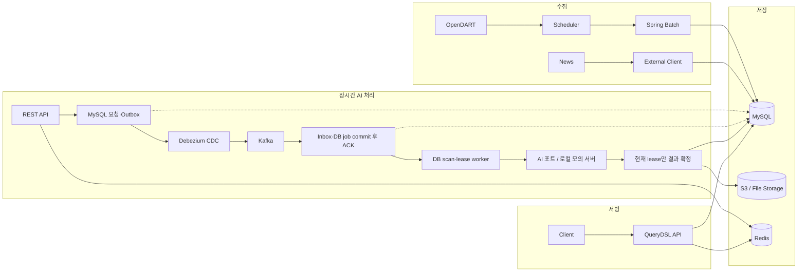

# SENTINEL

기업 재무·뉴스 데이터를 수집하고, 위험도와 AI 분석 결과를 조회 API로 제공하는 백엔드 플랫폼입니다.

기능 수보다 **데이터 수집 → 처리 → 저장 → 서빙 → 운영** 흐름에서 발생한 응답 지연, 장시간 외부 처리, 동시성, 정합성 문제를 해결하는 데 집중했습니다.

- 개발 기간: 2026.01 - 2026.03
- 로컬 복원·신뢰성 보강: 2026.11
- 팀 구성: 6명(백엔드 2명)
- 백엔드: Java 21, Spring Boot 3.5, MySQL 8, Redis 7, Kafka, QueryDSL
- 배포: Docker, AWS ECR, CodeBuild, CodeDeploy, EC2

## 핵심 엔지니어링 결과

| 문제 | 판단과 구현 | 확인한 결과 |
| --- | --- | --- |
| 적재 중단·재시도로 값이 누락되거나 미검증 데이터가 조회될 가능성 | snapshot/run/chunk 원장, 검증 후 활성 전환, 독립 CSV/OOXML·Decimal 대조 | **149,976개 위치**의 누락·추가·값 차이·중복 **0**, 실제 60,000개 적재 후 종료·재개 검증 |
| 요청 저장과 메시지 발행 사이 장애, 재전달·늦은 worker 완료 | 요청·Outbox 원자 저장 → CDC → Inbox/job commit 후 ACK → lease·재시도·결과 확정 | 적용 **15개 장애 조건×3회**, CDC 중단·broker 중단·응답 유실의 정상 복구 **900건 완료** |
| 재시작 후 대기 작업과 완료 PDF를 함께 복구해야 함 | DB·파일 정지 checkpoint를 별도 DB/broker에 복원하고 Outbox 재전달·Inbox 중복 방어 | 복원 **3회·303건 완료**, 기존 완료 PDF 크기·SHA 보존 및 신규 다운로드 확인 |
| 기업 개요에서 최신 보고서 버전을 고르는 조회 비용 | MAX 하위 조회를 NOT EXISTS로 변경하고 동일 응답·데이터로 전후 비교 | 동시 10명에서 P95 중앙값 **200.836→144.805ms(-27.90%)**, TPS **79.793→104.490(+30.95%)** |
| 상태 조회에 Redis를 추가해도 소유권 확인 SQL이 남음 | off/on/on/off 비교로 지연·변동·SQL·정합성을 함께 평가 | P95 중앙값 약 **3.73ms** 차이, SQL/조회 **1→1.0975**와 운영 비용을 고려해 **기본 cache-off** 유지 |
| 도메인 경계를 넘는 Entity/Repository·직접 SQL과 건별 서비스 호출 | 11개 닫힌 Modulith 모듈·DTO·읽기 스냅샷·SQL 소유권·배치 API | 구조/독립 기동 **16개 통과**, 20기업 finance 호출 **41→1회**, finance 배치 내부 SQL은 1/20기업 모두 **2회** |

위 결과는 WSL2 Ubuntu의 실제 MySQL·Redis·Kafka·Debezium과 모의 AI 서버에서 확인했습니다. 파일→DB 정합성, 장애 복구, 조회 성능은 각각 다른 조건의 실험입니다.

### 측정 조건과 결과의 범위

데이터 대조는 2,083기업·18지표·4분기의 149,976개 위치를 대상으로 했으며, NULL 8,656개와 0값 1,383개를 구분했습니다. 이는 원본 파일을 DB로 옮긴 값의 정합성 검증입니다. 전체 공시 사실이나 AI 분석 품질은 별도 검증 대상입니다.

| 실험 | 조건 | 해석 범위 |
| --- | --- | --- |
| 정지 복원 | 20사용자·대표 1기업/분기·고정 입력·worker 4개·cap 100, 매회 기존 대상 100건＋복원 후 신규 1건 | 총 303건. 온라인 백업·RPO0·다중 broker HA는 미검증 |
| 장애 복구 | CDC 중단·broker 중단·응답 유실 각각 100건×3회, 나머지는 결정적 경계 대상 사용 | 정상 복구 900건과 영구 오류의 예상 FAILED를 분리. 응답 유실은 매회 외부 101회·시도 101회·최종 결과 100개 |
| MySQL 조회 | 실제 재무 데이터, warm 30초/main 120초, 동시 10명·전후 각 3회 중앙값 비교 | 당시 M02 원시 CSV를 재계산한 값. 현재 코드의 새 성능 측정이나 인덱스 단독 효과로 확대하지 않음 |
| Redis 상태 캐시 | 20사용자·완료 100요청·동시 10명, warm 30초/main 120초, off/on/on/off 3회 | 각 모드 6회. P95 중앙값 36.122→32.393ms지만 반복 범위 중첩·인접 6쌍 중 3쌍 악화, 통계적 유의성 미검증 |

실행과 복원 경계는 [로컬 운영 절차](docs/runbooks/portfolio-local.md), 설계 선택은 [Kafka 선택 근거](docs/adr/0002-kafka-selection.md)와 [Redis 적용 범위](docs/adr/0003-redis-scope.md)에 정리했습니다. 수치 원자료·상세 결과·포트폴리오 참고 문서는 로컬에 보존하고 Git에서 제외합니다. 외부 AI 서버·메일·OAuth·외부 데이터 공급자의 실제 서비스 연결은 이 로컬 시험으로 보장하지 않습니다.

M07 당시 보강 후 최종 회귀는 Java607개·Python104개 통과, 실행 실패0개입니다. Java의 기존 비활성15개는 별도로 남아 있어 strict gate는 `INCOMPLETE`입니다. 위 장애3반복은 당시 기동 도구의 원자료이며, 이후 준비 파일 원자 공개와 복원 도구의 안전 검사를 보강한 현재 코드의 전체 회귀는 별도 실행으로 기록했습니다.

첫 장애 반복은 기존 91개 성공과 ACK 관측 시험의 별도 재실행 1개를 연결한 근거입니다. 최초 관측 실패 1회도 보존하며, 한 번에 전체 통과한 실행으로 표현하지 않습니다. CDC를 선택했으므로 polling 발행 경계는 N/A입니다. 고정 조건과 실제 시험은 [장애 조건](perf/fixtures/fault-matrix.json), [복구 통합 시험](src/test/java/com/aivle/project/reliability/ReportDeliveryRecoveryTest.java), [적재 중단·재개 시험](src/test/java/com/aivle/project/dataimport/ImportResumeIntegrationTest.java)에서 확인할 수 있습니다.

초기 팀 기록의 대시보드 P95 약 500→50ms와 AI 생성 약 80초는 위의 로컬 실험과 구분합니다. 당시 원시 측정 자료·EXPLAIN을 보존하지 않아 재검증한 수치로 사용하지 않습니다. 80초 작업의 개선은 생성 시간 단축보다 요청 스레드 점유를 분리한 결과입니다.

## 아키텍처



맞춤 보고서의 로컬 검증은 로컬 파일 저장소를 사용했습니다. 기존 Redis 기반 보고서 상태 경로와 새 MySQL 기반 맞춤 요청 경로는 아래에서 구분합니다.

| 단계 | 구현 | 역할 |
| --- | --- | --- |
| 수집 | Scheduler, Spring Batch, External Client | OpenDART 기업 데이터는 청크 처리하고 뉴스는 외부 연동 서비스로 수집 |
| 저장 | MySQL, S3/File Storage | 정형 데이터, 보고서 버전, PDF의 책임 분리 |
| 처리 | Kafka, Consumer, Spring Event | 장시간 AI 작업과 커밋 이후 후속 작업을 요청 경로에서 분리 |
| 분석 | 위험도·지표 평균 사전 집계 | 조회 시 반복 계산하지 않도록 읽기 모델 생성 |
| 서빙 | REST, QueryDSL, Redis | 필요한 컬럼만 조회하고 요청 상태·토큰·제한 상태 관리 |
| 운영 | Docker, CI/CD, Actuator | 빌드·배포·애플리케이션 상태 확인 자동화 |

## 1. 약 80초 외부 작업을 요청 생명주기에서 분리

AI 서버가 PDF를 생성할 때까지 API 요청을 유지하면 동시 요청 증가 시 서버 스레드 풀이 고갈될 수 있었습니다. 스레드 수를 늘리거나 Virtual Thread로 교체해도 대기 구조와 요청 생명주기는 그대로 남기 때문에 메시지 기반 분리를 선택했습니다.

```text
Before
Client → API ───────── 약 80초 대기 ─────────→ AI Server

After
Client → API → 202 Accepted + requestId
                 └→ Kafka → Consumer → AI Server → DB / File Storage
Client → 상태 조회 → PENDING → PROCESSING → COMPLETED / FAILED
```

- `requestId` 상태는 Redis에 24시간 TTL로 저장합니다.
- 상태 변경은 Lua로 원자화해 완료·실패 상태가 뒤늦은 `PROCESSING`으로 되돌아가지 않게 했습니다.
- Kafka가 비활성화됐거나 템플릿을 사용할 수 없는 환경에서는 동일 작업 메서드를 호출하는 `@Async` 경로로 폴백합니다.
- Retry·Circuit Breaker·Bulkhead가 외부 AI 호출의 일시 실패, 지속 장애, 동시 호출 수를 각각 제어합니다.

구현 근거: [CompanyAiController](src/main/java/com/aivle/project/app/internal/company/controller/CompanyAiController.java), [AiJobDispatchService](src/main/java/com/aivle/project/aiintegration/internal/job/AiJobDispatchService.java), [AiJobKafkaConsumer](src/main/java/com/aivle/project/app/internal/messaging/AiJobKafkaConsumer.java), [AiReportRequestStatusService](src/main/java/com/aivle/project/finance/internal/company/service/AiReportRequestStatusService.java)

맞춤 보고서 보강 경로는 추가 지시문·재무 snapshot을 요청 시 고정하고, 접수와 생성의 중단·재개를 분리합니다.

```text
API → MySQL 요청·Outbox commit → Debezium CDC → Kafka 요청 topic
    → Inbox·job commit → ACK → lease worker → 모의 AI → PDF·DB 확정
```

요청·슬롯·Outbox, 수신·job·상태, 결과·슬롯 반환의 각 원자성 경계를 분리했습니다. 재전달은 Inbox로 중복 등록을 막고, 잘못된 메시지는 격리 원문·DLT Outbox에 함께 기록합니다. 최종 실패의 관리 재개는 별도 generation과 감사 명령을 사용합니다. Kafka는 개별 보고서의 접수·실행 분리와 재전달, 상태 이벤트의 후속 소비 확장에 사용하며 단일 브로커의 중단·재개를 검증하는 범위입니다. 실행 절차와 한계는 [CDC 전달·복구](docs/runtime/messaging-recovery.md)에 정리했습니다.

## 2. 계산을 읽기 경로 밖으로 이동

대시보드 요청마다 전체 기업의 지표 평균과 위험도를 다시 계산하지 않고, 배치 단계에서 결과를 별도 테이블에 저장한 뒤 조회 API는 저장된 결과를 읽도록 변경했습니다.

- `metric_averages`: 분기·지표별 평균과 기업 수를 사전 집계
- `risk_score_summaries`: 기업·분기·보고서 버전별 위험 점수와 등급을 저장
- `(company_id, quarter_id)`: 워치리스트 대시보드의 필수 조회 조건에 맞춘 인덱스
- QueryDSL Projection: 엔티티 그래프 전체가 아니라 응답에 필요한 필드만 조회

당시 팀 기록은 대시보드 API P95 약500ms→50ms입니다. 원시 측정 자료를 보존하지 않아 현재 재검증한 수치로 인용하지 않으며, 인덱스 단독 효과로도 표현하지 않습니다. 원시 CSV가 남은 후속 로컬 비교는 위 M02 결과를 사용합니다.

구현 근거: [RiskScoreBatchService](src/main/java/com/aivle/project/finance/internal/risk/service/RiskScoreBatchService.java), [MetricAverageBatchService](src/main/java/com/aivle/project/finance/internal/metricaverage/service/MetricAverageBatchService.java), [CompanyWatchlistRepositoryImpl](src/main/java/com/aivle/project/watchlist/internal/repository/CompanyWatchlistRepositoryImpl.java), [V9 risk summary](src/main/resources/db/migration/V9__create_risk_score_summaries.sql), [V19 performance indexes](src/main/resources/db/migration/V19__add_performance_indexes.sql)

## 3. 동시성 문제에 하나의 Lock을 적용하지 않음

| 경쟁 구간 | 적용 수단 | 선택 이유 |
| --- | --- | --- |
| 존재하지 않는 워치리스트 행의 동시 INSERT | `UNIQUE(user_id, company_id)` | 존재하지 않는 행은 JPA 비관적 락의 대상이 될 수 없어 최종 정합성을 DB에 위임 |
| `max(versionNo) + 1` 보고서 버전 발급 | `PESSIMISTIC_WRITE` | 값을 읽는 시점부터 다음 버전 저장까지 부모 보고서 행 보호 |
| 로그인 실패 횟수 증가와 TTL 설정 | Redis Lua | `INCR`와 최초 `PEXPIRE` 사이의 실패 구간 제거 |

Redis Distributed Lock을 모든 문제에 일괄 적용하지 않고, 각 저장소가 제공하는 가장 작은 원자성 단위를 사용했습니다.

구현 근거: [V11 watchlist constraint](src/main/resources/db/migration/V11__create_company_watchlists.sql), [CompanyReportVersionIssueService](src/main/java/com/aivle/project/finance/internal/report/service/CompanyReportVersionIssueService.java), [LoginAttemptService](src/main/java/com/aivle/project/identity/internal/auth/service/LoginAttemptService.java)

## 4. 운영과 보안의 실패 경계

- 외부 AI 호출 7개 지점에 Retry·Circuit Breaker·Bulkhead를 적용하고 실패 원인을 `AI_TIMEOUT`, `AI_CIRCUIT_OPEN`, `AI_UNAVAILABLE`로 구분합니다.
- CodeBuild가 테스트와 이미지를 생성하고 ECR에 푸시하면, CodeDeploy가 EC2의 애플리케이션·Redis·Kafka 구성을 갱신합니다.
- 프로세스 실행 여부가 아니라 `/actuator/health` 응답 성공을 배포 완료 조건으로 사용합니다.
- Refresh Token과 이메일 인증 토큰은 평문 저장에서 HMAC-SHA256 + pepper 방식으로 전환했습니다.
- 쿠키 기반 refresh/logout 계열 API에는 double-submit CSRF 검증을 적용했습니다.

관련 문서: [토큰·CSRF 보안 강화](docs/security-hardening-issue-107.md), [HMAC pepper 전환](docs/security-hardening-issue-109.md), [배포 헬스체크](scripts/health-check.sh)

## 구현 상태와 다음 단계

README에서 구현한 내용과 확장 설계를 섞지 않습니다.

| 현재 구현 | 다음 단계 |
| --- | --- |
| 기존 Kafka Consumer/`@Async` 경로, 새 맞춤 요청의 CDC·DB commit 뒤 ACK·격리/DLT | 다중 브로커 가용성, CDC 실패의 자동 감시·재개 |
| 맞춤 요청 Outbox/Inbox·멱등 job·lease/재시도·본인 PDF·관리 재개·DB/파일 대조·실제 로그인/화면 연결 | 원격 AI 연동·품질·중복 과금 방지 검증 |
| 운영 runbook·정지 checkpoint/별도 환경 복원·적용 15개 장애 조건 3회·원본 보존 감사 | 온라인 백업·다른 호스트 복원·운영 감시 체계 |
| 새 맞춤 요청의 DB 기준 상태 캐시·버전 Lua·별도 소비 그룹/Redis 장애 복구 및 전후12회 비교 | 기본 cache-off 유지: 작은 지연 이득 대비 반복 편차·추가 SQL·운영 비용 확인 |
| 기존 보고서 경로의 Redis 요청 상태·Lua 전이 | 기존 경로의 장시간 `PROCESSING` 고착 복구 배치 |
| Docker Compose 기반 애플리케이션·Redis·Kafka 구성 | Kafka 다중 브로커, Redis Replica/Sentinel |
| CodeBuild → ECR → CodeDeploy → EC2, Health Gate | 부하·Scale-out 측정, Multi-AZ, Auto Scaling |

맞춤 보고서 보강은 WSL2 Ubuntu의 전용 MySQL·Kafka/Connect와 모의 AI HTTP 서버에서 검증합니다. 관리 앱 launcher가 CDC 수신과 worker를 켜면 HTTP 접수부터 본인 PDF 조회까지 연결됩니다. DB 장애 뒤 CDC task가 FAILED로 남는 경우에는 위치·이력을 유지하는 명시 복구 명령을 사용합니다. 실제 모델 품질이나 운영 배포 성과를 의미하지 않습니다. [맞춤 보고서 실행 문서](docs/runtime/custom-reports.md)와 [CDC 전달·복구](docs/runtime/messaging-recovery.md)를 참고하세요.

`frontend/`의 기업 상세 화면에서 추가 내용 입력·응답 유실 후 같은 키 재전송·새로고침 후 추적·본인 PDF 다운로드를 연결했습니다. 새 상태 캐시는 MySQL 소유권/현재 버전을 확인하며 실패 시 DB로 조회합니다. 기존 Redis 기반 보고서 상태 경로와 구분하며, 성능 이득을 전제로 하지 않습니다. [화면·캐시 실행과 측정 조건](docs/runtime/browser-and-measurement.md)을 참고하세요.

## 도메인 경계와 추후 서비스 분리

단일 Spring Boot 애플리케이션을 Spring Modulith **11개 모듈**로 구분했습니다. 계정/인증, 원천 재무·적재, 맞춤 보고서, AI 전송, 조회 조립의 책임을 나누고 공개 API와 DTO·읽기 스냅샷로 연결합니다. 다른 모듈의 Entity/Repository와 내부 타입 참조는 구조 시험으로 차단합니다.

모듈별 `STANDALONE` 기동, 공개 계약 검사, SQL 소유권 검사와 대표 MySQL 제한 계정 시험을 함께 둡니다. 관심기업 기본정보는 기업별 finance 호출을 배치 API로 바꾸고, 1개/20개 기업의 SQL 수와 기존 단일 조회의 JSON 동등성을 확인합니다. 관리 재개·격리 재전달 CLI도 전체 웹 앱과 별도로 실행해 연결을 검증합니다.

현재는 동일 JVM·동일 DB입니다. 요청/슬롯/Outbox 및 파일 메타/완료의 로컬 트랜잭션과 모듈 간 FK 16개를 유지합니다. 독립 DB/서버 추출 전에는 source 보존, 계정 상태 전파, 파일 확정/보상과 키 배포 정책을 별도로 검증해야 합니다. [모듈·테이블 소유권](docs/architecture/module-ownership.md), [선택과 추출 제약](docs/adr/0004-modulith-boundaries.md)에 정리했습니다.

현재 모듈 전환의 Java 근거는 최초 전체657개 실행과 실패1개의 시험 조립 보강/재실행을 연결한 **642통과·기존15비활성**입니다. 생산 코드 입력은 동일하며 한 번의 전체 통과로 표현하지 않습니다. 검토 보강 후 Python114개·브라우저13개(UI 계약12·실제 흐름1)와 빌드도 통과했습니다. strict gate는 기존15개 때문에 `INCOMPLETE`입니다.

finance 배치의 SQL2회는 관심기업 관계/인증을 포함한 전체 HTTP 비용과 구분합니다. 상태 조회 서비스는 계정 확인을 분리해 기본2회/cache hit2회/cold4회로 비용이 증가했습니다. 위 M02/M04 수치는 당시 코드의 결과이며 현재 모듈 전환의 새 비교와 합치지 않습니다. 실제 화면의 맞춤 PDF 흐름과, 모의 서버가 제공하지 않는 기존 뉴스·공시 분석 연동도 구분합니다.

새 비교는 조회6회·보고서10회(정상9·가드1)로 마감했습니다. 조회57,742건의 오류/응답 불일치0·SQL11을 확인했으나 반복 편차가 커 시간 개선 판정은 유보했습니다. 보고서1/s의 완료 P95 중앙값은2267.709→2274.020ms였고, 5/s는 변경 후 첫 실행에서 클라이언트 미완료 관측200가드가 동작해 후속2회를 실행하지 않았습니다. 정상본2520건과 가드본590건은 모두 완료됐으며 단축 구간의 정규TPS는N/A입니다.

## 기술 선택

| 영역 | 기술 | 사용 목적 |
| --- | --- | --- |
| Backend | Java 21, Spring Boot 3.5, Spring Security | API, 인증·인가, 트랜잭션 경계 |
| Data | MySQL 8, JPA, QueryDSL, Flyway | 정합성, 동적 조회, 스키마 버전 관리 |
| Batch | Spring Batch, Scheduler | 기업 데이터 수집과 사전 집계 |
| Messaging | Kafka, Debezium CDC, Outbox/Inbox, Spring Event | 커밋된 요청의 전달·중복 수신 방어·실행 원장 분리 |
| Cache/State | Redis 7, Lua | 요청 상태, 인증 토큰, 횟수 제한의 원자적 갱신 |
| Resilience | Resilience4j | Retry, Circuit Breaker, Bulkhead |
| Infra | Docker, AWS ECR, CodeBuild, CodeDeploy, EC2 | 이미지 기반 빌드·배포와 헬스 검증 |
| Test/Measure | JUnit 5, Mockito, MockWebServer, Docker Compose, Python, p6spy | 단위·실제 인프라 회귀, HTTP·SQL·부하 계측. JMeter JMX는 미실행 템플릿 |

## 실행과 검증

### 사전 준비

- Java 21
- WSL2 Ubuntu와 Docker Engine — 로컬 검증 기준 환경
- `.env.example`을 복사한 `.env`
- `secrets/jwt/private.pem`, `secrets/jwt/public.pem` RSA 키 쌍
- `.env`의 `APP_TOKEN_HASH_PEPPER_B64`와 필요한 외부 연동 값

민감 정보와 키 파일은 저장소에 커밋하지 않습니다.

### 테스트

애플리케이션·Gradle·Docker 기반 검증은 Ubuntu 안에서 실행했습니다. 전용 서비스·비밀 파일·격리 namespace 준비는 [로컬 실행 환경](docs/runtime/local-environment.md), 정지·복원·장애 시험은 [운영 절차](docs/runbooks/portfolio-local.md)를 따릅니다. 원본과 시험 환경은 고정 포트를 공유하므로 순차 운영합니다.

```bash
env -u SPRING_DATASOURCE_URL -u SPRING_DATASOURCE_USERNAME -u SPRING_DATASOURCE_PASSWORD -u SPRING_DATASOURCE_DRIVER_CLASS_NAME -u SPRING_PROFILES_ACTIVE bash ./gradlew fastTest --no-daemon
```

실제 인프라·CDC·복구 시험은 위 운영 절차의 격리 환경과 전용 도구로 실행합니다. 빠른 회귀 시험은 앱용 DB 환경 변수가 H2 테스트 설정을 덮지 않도록 분리합니다.

### 기존 애플리케이션 Compose 실행

```bash
cp .env.example .env
mkdir -p secrets/jwt logs upload/files

bash ./gradlew bootJar
docker build -t sentinel-backend:local .

export APP_IMAGE=sentinel-backend:local
export ENV_FILE=.env
export LOCAL_ENV_FILE=.env
docker compose -f docker-compose.app.yml -f docker-compose.local.yml up -d
```

`.env`와 JWT 키를 준비한 뒤 실행해야 합니다.

- Health: `http://localhost:8080/actuator/health`
- Swagger UI: `http://localhost:8080/swagger-ui.html`

종료:

```bash
docker compose -f docker-compose.app.yml -f docker-compose.local.yml down
```

## 문서와 재현 경로

| 주제 | 문서·코드 |
| --- | --- |
| Virtual Thread 전후 부하 측정 절차 | [Phase 1 JMeter benchmark](docs/perf-phase1-virtual-thread-benchmark.md) |
| OpenDART 기업 코드 동기화 | [DART corp sync](docs/dart-corp-sync.md) |
| 기업 검색 API | [Company search](docs/company-search.md) |
| 보고서 지표 적재·조회 | [Metric import](docs/report-metric-import.md), [Metric query](docs/report-metric-query.md) |
| ERD와 마이그레이션 | [ERD](ERD.md), [`db/migration`](src/main/resources/db/migration) |
| CI/CD | [buildspec.yml](buildspec.yml), [appspec.yml](appspec.yml), [`scripts`](scripts) |
| 모듈 경계·검증 | [소유권](docs/architecture/module-ownership.md), [ADR](docs/adr/0004-modulith-boundaries.md), [구조 시험](src/test/java/com/aivle/project/architecture/ApplicationModulesTest.java) |

## 저장소 구조

```text
src/main/java/com/aivle/project
├── identity/         # 계정·권한·JWT·refresh
├── finance/          # 원천 재무·적재·snapshot·기업·지표
├── reporting/        # 맞춤 보고서·Outbox/Inbox·job·확정·복구
├── aiintegration/    # AI HTTP 전송·오류 분류
├── watchlist/        # 관심기업 관계
├── insight/          # 사업보고서 해석·분석 조립
├── news/             # 뉴스·평판
├── community/        # 게시물·댓글·첨부 권한
├── storage/          # 파일 메타·로컬/S3 저장
├── app/              # HTTP/보안 정책·이벤트·화면 조립
└── foundation/       # 순수 공통 타입·오류·해시

src/main/resources/db/migration/  # MySQL Flyway
src/test/                         # 단위·통합 테스트
perf/                             # JMeter와 런타임 지표 수집
scripts/                          # CodeDeploy 훅과 헬스체크
```
