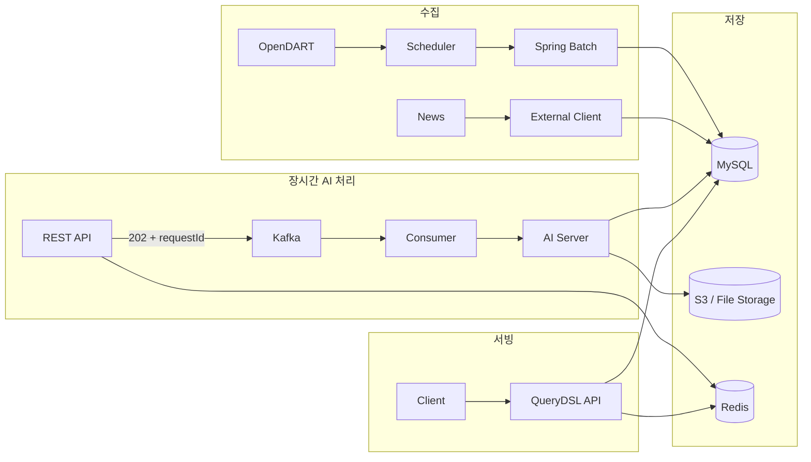

# SENTINEL

기업 재무·뉴스 데이터를 수집하고, 위험도와 AI 분석 결과를 조회 API로 제공하는 백엔드 플랫폼입니다.

기능 수보다 **데이터 수집 → 처리 → 저장 → 서빙 → 운영** 흐름에서 발생한 응답 지연, 장시간 외부 처리, 동시성, 정합성 문제를 해결하는 데 집중했습니다.

- 개발 기간: 2026.01 - 2026.03
- 팀 구성: 6명(백엔드 2명)
- 백엔드: Java 21, Spring Boot 3.5, MySQL 8, Redis 7, Kafka, QueryDSL
- 배포: Docker, AWS ECR, CodeBuild, CodeDeploy, EC2

## 핵심 엔지니어링 결과

| 문제 | 판단과 구현 | 확인한 결과 |
| --- | --- | --- |
| 대시보드 요청마다 전체 기업 평균·위험도를 계산 | `metric_averages`, `risk_score_summaries` 사전 집계와 조회 조건에 맞춘 복합 인덱스 적용 | API P95 약 **500ms → 50ms** |
| AI 리포트 생성 중 요청 스레드가 약 80초 점유 | `202 Accepted + requestId`로 먼저 응답하고 Kafka Consumer가 작업 수행 | 요청 처리와 장시간 작업의 생명주기 분리 |
| 동시 요청에서 중복 등록·버전 충돌·TTL 누락 가능 | DB Unique Constraint, 비관적 락, Redis Lua를 문제 성격에 따라 분리 적용 | 저장소가 보장하는 원자성 경계로 정합성 보호 |
| 외부 AI 장애와 배포 실패가 서비스 장애로 전파될 가능성 | Retry·Circuit Breaker·Bulkhead, 애플리케이션 Health Gate 적용 | 외부 호출과 배포 완료 조건을 명시적인 실패 경계로 분리 |

> 대시보드 수치는 사전 집계 구조와 인덱스 재설계를 함께 적용한 뒤 측정한 값입니다. 당시 `EXPLAIN` 출력은 보관하지 않아 두 변경의 기여도를 개별 수치로 분리하지 않습니다. 80초 작업 역시 처리 시간 자체를 줄인 결과가 아니라 요청 스레드 점유를 제거한 결과입니다.

## 아키텍처



| 단계 | 구현 | 역할 |
| --- | --- | --- |
| 수집 | Scheduler, Spring Batch, External Client | OpenDART 기업 데이터는 청크 처리하고 뉴스는 외부 연동 서비스로 수집 |
| 저장 | MySQL, S3/File Storage | 정형 데이터, 보고서 버전, PDF의 책임 분리 |
| 처리 | Kafka, Consumer, Spring Event | 장시간 AI 작업과 커밋 이후 후속 작업을 요청 경로에서 분리 |
| 분석 | 위험도·지표 평균 사전 집계 | 조회 시 반복 계산하지 않도록 읽기 모델 생성 |
| 서빙 | REST, QueryDSL, Redis | 필요한 컬럼만 조회하고 요청 상태·토큰·제한 상태 관리 |
| 운영 | Docker, CI/CD, Actuator | 빌드·배포·애플리케이션 상태 확인 자동화 |

## 1. 약 80초 외부 작업을 요청 생명주기에서 분리

AI 서버가 PDF를 생성할 때까지 API 요청을 유지하면 동시 요청 증가 시 서버 스레드 풀이 고갈될 수 있었습니다. 스레드 수를 늘리거나 Virtual Thread로 교체해도 대기 구조와 요청 생명주기는 그대로 남기 때문에 메시지 기반 분리를 선택했습니다.

```text
Before
Client → API ───────── 약 80초 대기 ─────────→ AI Server

After
Client → API → 202 Accepted + requestId
                 └→ Kafka → Consumer → AI Server → DB / File Storage
Client → 상태 조회 → PENDING → PROCESSING → COMPLETED / FAILED
```

- `requestId` 상태는 Redis에 24시간 TTL로 저장합니다.
- 상태 변경은 Lua로 원자화해 완료·실패 상태가 뒤늦은 `PROCESSING`으로 되돌아가지 않게 했습니다.
- Kafka가 비활성화됐거나 템플릿을 사용할 수 없는 환경에서는 동일 작업 메서드를 호출하는 `@Async` 경로로 폴백합니다.
- Retry·Circuit Breaker·Bulkhead가 외부 AI 호출의 일시 실패, 지속 장애, 동시 호출 수를 각각 제어합니다.

구현 근거: [CompanyAiController](src/main/java/com/aivle/project/company/controller/CompanyAiController.java), [AiJobDispatchService](src/main/java/com/aivle/project/company/job/AiJobDispatchService.java), [AiJobKafkaConsumer](src/main/java/com/aivle/project/company/job/AiJobKafkaConsumer.java), [AiReportRequestStatusService](src/main/java/com/aivle/project/company/service/AiReportRequestStatusService.java)

## 2. 계산을 읽기 경로 밖으로 이동

대시보드 요청마다 전체 기업의 지표 평균과 위험도를 다시 계산하지 않고, 배치 단계에서 결과를 별도 테이블에 저장한 뒤 조회 API는 저장된 결과를 읽도록 변경했습니다.

- `metric_averages`: 분기·지표별 평균과 기업 수를 사전 집계
- `risk_score_summaries`: 기업·분기·보고서 버전별 위험 점수와 등급을 저장
- `(company_id, quarter_id)`: 워치리스트 대시보드의 필수 조회 조건에 맞춘 인덱스
- QueryDSL Projection: 엔티티 그래프 전체가 아니라 응답에 필요한 필드만 조회

이 변경은 대시보드 API P95를 약 500ms에서 50ms로 낮췄습니다. 수치는 동일 변경 전후의 결과이며, 근거가 남아 있지 않은 인덱스 단독 효과로 표현하지 않습니다.

구현 근거: [RiskScoreBatchService](src/main/java/com/aivle/project/risk/service/RiskScoreBatchService.java), [MetricAverageBatchService](src/main/java/com/aivle/project/metricaverage/service/MetricAverageBatchService.java), [CompanyWatchlistRepositoryImpl](src/main/java/com/aivle/project/watchlist/repository/CompanyWatchlistRepositoryImpl.java), [V9 risk summary](src/main/resources/db/migration/V9__create_risk_score_summaries.sql), [V19 performance indexes](src/main/resources/db/migration/V19__add_performance_indexes.sql)

## 3. 동시성 문제에 하나의 Lock을 적용하지 않음

| 경쟁 구간 | 적용 수단 | 선택 이유 |
| --- | --- | --- |
| 존재하지 않는 워치리스트 행의 동시 INSERT | `UNIQUE(user_id, company_id)` | 존재하지 않는 행은 JPA 비관적 락의 대상이 될 수 없어 최종 정합성을 DB에 위임 |
| `max(versionNo) + 1` 보고서 버전 발급 | `PESSIMISTIC_WRITE` | 값을 읽는 시점부터 다음 버전 저장까지 부모 보고서 행 보호 |
| 로그인 실패 횟수 증가와 TTL 설정 | Redis Lua | `INCR`와 최초 `PEXPIRE` 사이의 실패 구간 제거 |

Redis Distributed Lock을 모든 문제에 일괄 적용하지 않고, 각 저장소가 제공하는 가장 작은 원자성 단위를 사용했습니다.

구현 근거: [V11 watchlist constraint](src/main/resources/db/migration/V11__create_company_watchlists.sql), [CompanyReportVersionIssueService](src/main/java/com/aivle/project/report/service/CompanyReportVersionIssueService.java), [LoginAttemptService](src/main/java/com/aivle/project/auth/service/LoginAttemptService.java)

## 4. 운영과 보안의 실패 경계

- 외부 AI 호출 7개 지점에 Retry·Circuit Breaker·Bulkhead를 적용하고 실패 원인을 `AI_TIMEOUT`, `AI_CIRCUIT_OPEN`, `AI_UNAVAILABLE`로 구분합니다.
- CodeBuild가 테스트와 이미지를 생성하고 ECR에 푸시하면, CodeDeploy가 EC2의 애플리케이션·Redis·Kafka 구성을 갱신합니다.
- 프로세스 실행 여부가 아니라 `/actuator/health` 응답 성공을 배포 완료 조건으로 사용합니다.
- Refresh Token과 이메일 인증 토큰은 평문 저장에서 HMAC-SHA256 + pepper 방식으로 전환했습니다.
- 쿠키 기반 refresh/logout 계열 API에는 double-submit CSRF 검증을 적용했습니다.

관련 문서: [토큰·CSRF 보안 강화](docs/security-hardening-issue-107.md), [HMAC pepper 전환](docs/security-hardening-issue-109.md), [배포 헬스체크](scripts/health-check.sh)

## 구현 상태와 다음 단계

README에서 구현한 내용과 확장 설계를 섞지 않습니다.

| 현재 구현 | 다음 단계 |
| --- | --- |
| Kafka 단일 브로커, Consumer, `@Async` 폴백 | DLT, Outbox, `requestId` 멱등 소비 |
| Redis 기반 요청 상태와 Lua 상태 전이 | 장시간 `PROCESSING` 고착 복구 배치 |
| Docker Compose 기반 애플리케이션·Redis·Kafka 구성 | Kafka 다중 브로커, Redis Replica/Sentinel |
| CodeBuild → ECR → CodeDeploy → EC2, Health Gate | 부하·Scale-out 측정, Multi-AZ, Auto Scaling |

## 기술 선택

| 영역 | 기술 | 사용 목적 |
| --- | --- | --- |
| Backend | Java 21, Spring Boot 3.5, Spring Security | API, 인증·인가, 트랜잭션 경계 |
| Data | MySQL 8, JPA, QueryDSL, Flyway | 정합성, 동적 조회, 스키마 버전 관리 |
| Batch | Spring Batch, Scheduler | 기업 데이터 수집과 사전 집계 |
| Messaging | Kafka, Spring Event | 장시간 작업과 커밋 이후 후속 처리 분리 |
| Cache/State | Redis 7, Lua | 요청 상태, 인증 토큰, 횟수 제한의 원자적 갱신 |
| Resilience | Resilience4j | Retry, Circuit Breaker, Bulkhead |
| Infra | Docker, AWS ECR, CodeBuild, CodeDeploy, EC2 | 이미지 기반 빌드·배포와 헬스 검증 |
| Test/Measure | JUnit 5, Mockito, MockWebServer, Testcontainers, JMeter, p6spy | 단위·통합 테스트와 SQL·부하 관찰 |

## 실행과 검증

### 사전 준비

- Java 21
- Docker Desktop
- `.env.example`을 복사한 `.env`
- `secrets/jwt/private.pem`, `secrets/jwt/public.pem` RSA 키 쌍
- `.env`의 `APP_TOKEN_HASH_PEPPER_B64`와 필요한 외부 연동 값

민감 정보와 키 파일은 저장소에 커밋하지 않습니다.

### 테스트

```powershell
.\gradlew.bat test
```

### 로컬 Docker 실행

```powershell
Copy-Item .env.example .env
New-Item -ItemType Directory -Force secrets/jwt, logs, upload/files

.\gradlew.bat bootJar
docker build -t sentinel-backend:local .

$env:APP_IMAGE = "sentinel-backend:local"
$env:ENV_FILE = ".env"
$env:LOCAL_ENV_FILE = ".env"
docker compose -f docker-compose.app.yml -f docker-compose.local.yml up -d
```

`.env`와 JWT 키를 준비한 뒤 실행해야 합니다.

- Health: `http://localhost:8080/actuator/health`
- Swagger UI: `http://localhost:8080/swagger-ui.html`

종료:

```powershell
docker compose -f docker-compose.app.yml -f docker-compose.local.yml down
```

## 문서와 재현 경로

| 주제 | 문서·코드 |
| --- | --- |
| Virtual Thread 전후 부하 측정 절차 | [Phase 1 JMeter benchmark](docs/perf-phase1-virtual-thread-benchmark.md) |
| OpenDART 기업 코드 동기화 | [DART corp sync](docs/dart-corp-sync.md) |
| 기업 검색 API | [Company search](docs/company-search.md) |
| 보고서 지표 적재·조회 | [Metric import](docs/report-metric-import.md), [Metric query](docs/report-metric-query.md) |
| ERD와 마이그레이션 | [ERD](ERD.md), [`db/migration`](src/main/resources/db/migration) |
| CI/CD | [buildspec.yml](buildspec.yml), [appspec.yml](appspec.yml), [`scripts`](scripts) |

## 저장소 구조

```text
src/main/java/com/aivle/project
├── auth/             # JWT, refresh rotation, 로그인 제한
├── company/          # 기업 조회, AI 작업, OpenDART/뉴스 연동
├── dashboard/        # 대시보드 조회
├── metricaverage/    # 지표 평균 사전 집계
├── report/           # 보고서·버전·지표·PDF
├── risk/             # 위험도 계산과 요약
└── watchlist/        # 관심 기업과 대시보드 QueryDSL 조회

src/main/resources/db/migration/  # MySQL Flyway
src/test/                         # 단위·통합 테스트
perf/                             # JMeter와 런타임 지표 수집
scripts/                          # CodeDeploy 훅과 헬스체크
```
