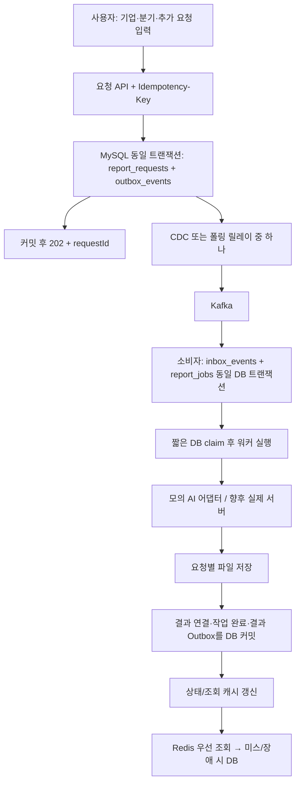

# SENTINEL 포트폴리오 보강 설계 초안

작성일: 2026-11-02 / 목적·범위 재검토 및 방향성 사용자 동의: 2026-11-03 / 상태: 방향성 승인, 세부 구현·측정 계획 작성. 이번 요청에서는 구현·환경 설치·DB 변경을 수행하지 않는다.

## 목적과 범위

사용자가 직접 추가할 내용을 입력해 맞춤 보고서 생성을 요청하는 향후 기능을 기준으로, 요청 접수·작업 전달·실행·결과 저장이 장애 후에도 추적되고 복구되도록 만든다. 실제 데이터 적재의 재시도와 정확성 검증, MySQL 성능 기준선, Redis 활용과 Kafka 장애 실험을 포트폴리오 증거로 남긴다.

사용자가 정한 우선순위: CDC를 통한 Outbox 발행을 먼저 검토하고 불가능하면 스케줄링 폴링을 사용한다. 연도별 대용량 데이터 축적·파티셔닝·보관 전략은 이번 범위에서 제외한다. Redis 적용 대상은 코드와 측정 결과를 보고 제안한다.

현재 외부 AI 서버는 사용할 수 없다. 구현 목표는 사용자 추가 요청을 접수·저장·전달하고 모의 AI 서버의 입력 수신, 유효한 시험 PDF 반환, 결과 저장·상태 조회·다운로드까지 검증하는 것이다. 실제 맞춤 생성 모델·프롬프트 품질은 구현 완료로 표현하지 않는다. 맞춤 UI는 추가 요청 문구를 입력하는 최소 화면만 범위에 넣고, 전체 프런트엔드 개편은 하지 않는다.

## 포트폴리오 목적에 따른 완료 범위

공개 서비스 배포는 이번 완료 조건에 포함하지 않는다. 실제 사용자 요청을 다룬다고 가정한 데이터 보존·권한·실패 처리·기본 운영 절차를 로컬의 실제 MySQL/Redis/Kafka와 제어 가능한 모의 AI 서버에서 검증한다. 목표는 맞춤 보고서 한 흐름의 완결성과 세 대표 사례(요청 복구, 적재 정합성, 조회 성능)를 입증하는 것이다.

- 필수: 최소 맞춤 요청 입력→접수→Outbox 발행→Inbox/작업 실행→시험 PDF 저장→본인 상태 조회·다운로드, 중복/실패/재시작 복구, 실제 데이터 적재·검증, MySQL 기준선과 병목 한 경로의 개선 또는 불채택 근거, 기본 운영 점검, 재현 문서와 원자료.
- 발행 경로: CDC를 먼저 실제 검증하고 가능하면 구현한다. 확인된 환경 제약으로 불가능할 때만 폴링으로 대체한다. 선택한 한 경로와 그에 해당하는 장애 시험을 완료하면 되며 두 릴레이를 모두 구현하는 것을 목표로 하지 않는다.
- 조건부 확장: Redis에서 먼저 계산한 집계의 DB 지연 반영, 다중 브로커 복제 내결함성, binlog/토픽 보존 범위 초과에 대한 자동 복구는 기본 흐름과 대표 증거를 완성한 뒤 필요성과 자원에 따라 진행한다. 보존 범위 초과 시의 한계·수동 대조 절차 설명은 기본 문서에 남긴다.
- 후속 범위: 연도별 대량 데이터/파티셔닝, 실제 AI 모델 품질, 공개 클라우드 배포와 상시 고가용성 운영, 독립 알림/감사 서비스, 전체 UI 개편. 향후 소비자 확장은 선택 근거와 이벤트 계약으로만 설명한다.
- H2·모킹 시험은 빠른 회귀 검증에 사용하고, 최종 증거에는 실제 MySQL·Redis·Kafka를 연결한 시험을 포함한다. 기존 인증·권한·일반 보고서·관심기업·파일 기능의 영향 범위도 회귀 검증한다.

## 현재 코드에서 확인한 변경 이유

- `CompanyAiController.requestAiReport`: Redis에 PENDING 저장 → Kafka 직접 전송 또는 로컬 비동기 실행. DB 요청 원장이 없다.
- `AiJobDispatchService`: KafkaTemplate.send의 비동기 완료를 확인하지 않고 true를 반환한다. DB 저장과 발행의 원자성을 제공하지 않는다.
- `AiReportRequestStatusService`: 상태를 Redis에 24시간 보존한다. TTL 만료·Redis 데이터 소실 후 DB에서 복구하는 경로가 없다.
- `CompanyAiService.processReportGeneration`: 기업/분기만으로 기존 PDF를 재사용하고 Redis 락으로 같은 단위 생성을 제한한다. 사용자별 다른 추가 요청을 구분하지 못한다. 내부 예외를 FAILED 기록 후 삼키므로 Kafka 재시도와 책임 경계가 불명확하다.
- `CompanyAiReportStoreService`: 파일 저장과 DB 메타데이터 저장이 한 DB 트랜잭션 안에 있어도 파일 저장소까지 원자적이지는 않다.
- `CompanyReportMetricImportService`: 한 트랜잭션에서 다수 기업을 저장하고 무결성 예외를 잡아 로그로 처리한다. 같은 파일 재업로드 시 새 버전이 생길 수 있으며, 트랜잭션 실패·재시작에 대한 영속적 진행 기록이 부족하다. 실제 MySQL 재현으로 확정하고 보강한다.
- `CompanyReportMetricValuesEntity.metricValue`: DECIMAL(20,4)다. 원본 CSV와 DB를 무조건 소수점 전체 일치로 비교하면 안 된다.

## 접근법 비교와 제안

| 접근법 | 장점 | 비용/제약 | 판단 |
| --- | --- | --- | --- |
| MySQL 요청+Outbox → Debezium CDC → Kafka → Inbox/Job | 커밋된 요청을 binlog 기반으로 전달, 커넥터 위치에서 재개 | Kafka Connect·binlog·권한·보존·운영 지표가 추가됨 | 사용자 우선순위에 맞는 기본안. 로컬 검증 후 확정 |
| 동일 요청+Outbox → 스케줄러 폴링 → Kafka → 동일 Inbox/Job | 구성 요소를 줄이고 Java에서 직접 제어 | 폴링 쿼리·지연·다중 릴레이 claim/lease 필요 | CDC 운영 불가 사유가 실제로 확인될 때 대안 |
| Redis 단독 접수 → 나중에 MySQL | 초기 응답을 가볍게 만들 수 있음 | Redis 장애·영속화 간격·미반영 데이터 복구가 별도 문제 | 유실 방지가 중요한 핵심 접수에는 권하지 않음 |

채택 여부는 CDC 검증 결과로 결정한다. CDC 연결이 잠깐 끊긴 것을 ‘CDC 불가’로 간주하지 않는다. 동일 Outbox를 CDC와 폴링이 동시에 발행하는 자동 전환은 만들지 않는다. 필요 시 운영자가 이전 발행기를 정지하고 복구 위치를 확인해 전환하며, 재전달은 동일 eventId로 처리한다.

## 제안하는 구조

### 보장할 불변조건

1. 202는 요청 원장과 최초 Outbox 이벤트의 DB 커밋 이후에만 반환한다. DB 장애로 접수하지 못한 요청은 성공 처리하지 않는다.
2. 동일 사용자+Idempotency-Key+같은 요청은 같은 requestId를 반환한다. 키를 먼저 조회해 재시도 중 최신 분기/데이터가 바뀌어도 최초 요청의 해석 결과를 유지한다. 같은 키에 다른 요청 본문이면 409를 반환한다. 고유 제약과 payload hash로 동시 요청에도 적용한다.
3. 최소 한 번 전달을 전제로 동일 이벤트가 반복돼도 DB의 업무 결과가 중복 반영되지 않도록 한다. Kafka 설정만으로 외부 HTTP·MySQL·파일 저장소까지 정확히 한 번 실행을 보장한다고 표현하지 않는다.
4. 요청 내용과 기준 재무 데이터 버전은 접수 시 고정한다. 회사·분기만 같다고 다른 사용자의 추가 요구나 파일을 재사용하지 않는다.
5. 재시도 중에는 RETRY_WAIT를 사용한다. FAILED는 자동 재시도 소진 또는 영구 오류로 자동 실행이 끝난 상태다. 일반 이벤트 재전달로 이를 되살리지 않는다. 원인 제거 후 명시적인 관리 재개만 recoveryGeneration을 올려 허용하고, 상태 변경은 version/attempt/generation 조건을 검사해 늦은 응답이 최신 상태를 되돌리지 못하게 한다.
6. Redis 장애·TTL 만료가 접수된 요청이나 완료된 결과의 유실을 뜻하지 않게 한다. 요청 소유권은 DB/인증 기준으로 검증한다.
7. 유한한 로컬 실험에서 강제 종료 후 접수 건수와 최종/대기/격리 건수를 대조한다. 단일 PC 디스크 영구 손실까지 무손실이라고 주장하지 않는다.

### 요청·이벤트·중복 처리 단위

- `requestId`: 사용자 요청의 고유 ID. 최초 서버 시간과 해석된 대상 분기까지 저장한다.
- 입력 스냅샷: userId, companyId, targetQuarterKey, additionalInstructions, sourceSnapshotId, reportTemplateVersion, 요청 본문 해시. 텍스트 최대 2,000자를 초안 기본값으로 제안한다. 기존 보고서 요청 API는 유지하고 새 JSON 접수 경로를 추가해 기존 클라이언트와 호환한다.
- `eventId`: 이벤트의 고유 ID. 재발행에는 같은 ID를 사용하고, 작업 시도 attemptId와 구분한다. envelope에는 eventType, schemaVersion, aggregateId=requestId, occurredAt을 둔다.
- Inbox 고유 키: `(consumer_name, event_id)`. Inbox 삽입과 report_jobs 생성/요청 ENQUEUED 반영을 한 DB 트랜잭션에서 완료한 뒤 Kafka offset을 커밋한다. 이는 ‘수신·작업 등록 완료’이며 AI 생성 완료와 같지 않다.
- 장시간 AI 작업은 Kafka 리스너 트랜잭션 안에서 수행하지 않는다. 워커가 durable job을 claim한 뒤 별도 실행하고, lease 만료·재시작 시 복구한다. 등록 직후 실행 신호가 사라진 READY 작업과 기한이 지난 재시도도 복구 스캐너가 회수한다. 이 복구 스캔은 Outbox 발행 폴링과 별도 책임이다.
- 최종 결과 연결은 requestId에 대한 고유 제약으로 한 번만 확정한다. worker lease token/fencing version을 검사해 만료된 워커의 뒤늦은 커밋을 거부한다. 외부 호출 동안 DB 트랜잭션·행 잠금을 유지하지 않는다.
- 현재 회사/분기 보고서 버전 구조는 유지하되 맞춤 요청과 산출물 연결을 별도로 둔다. 기존 기본 보고서와 개인 맞춤 보고서는 같은 캐시 키로 재사용하지 않는다.
- snapshot A로 접수한 뒤 B가 활성화돼도 워커의 실제 조회·AI 입력·재시도는 A를 사용한다. snapshot ID만 기록하고 현재 활성 데이터를 읽는 구현을 허용하지 않는다. 미완료 요청이 참조하는 snapshot을 먼저 삭제하지 않는다.

### 외부 AI·파일 저장의 한계와 복구

- 실제 서버가 향후 Idempotency-Key와 작업 조회를 지원하면 requestId를 전달해 재호출 비용까지 줄인다. 현재 클라이언트는 회사 코드 기반 GET이므로 이 계약을 지원한다고 가정하지 않는다.
- 타임아웃은 ‘서버가 작업하지 않았다’는 뜻이 아니다. 외부 서버가 멱등성을 지원하지 않으면 중복 호출 자체는 남을 수 있다. 로컬 어댑터에서는 호출 횟수와 DB 결과 확정 횟수를 따로 검증한다.
- 파일은 요청/시도별 임시 경로에 쓰고 체크섬·실제 PDF 유효성을 확인한 다음 DB 결과에 연결한다. DB 커밋 실패 후 남은 파일은 고아 파일 정리 대상으로 기록한다. 완료된 요청을 재처리해 파일/버전을 다시 만들지 않는다.
- 재시도 주체는 워커의 영속 상태로 통합한다. HTTP 클라이언트 재시도와 Kafka 재시도가 곱해지지 않게 한다. 초기안은 최대 3회, 지수 백오프+jitter이며 수치는 장애 실험에서 조정한다.
- 형식 오류·지원하지 않는 스키마·참조 불가 같은 영구 오류와 timeout/5xx 같은 일시 오류를 구분한다. 독성 메시지는 격리/DLT하고 원본 eventId·이유·처리 이력을 남긴다. DLT 발행 확인 전 원본을 버리지 않으며 DLT 자체 실패도 시험한다.

### 자동 재시도 종료 후의 명시적 복구

- FAILED job이 존재할 때 같은 원본 이벤트를 재발행하면 Inbox의 중복 제거로 실행되지 않는 것이 정상이다. 복구는 원인 제거 후 권한을 제한한 작은 관리 명령으로 기존 job을 재개한다. 별도 관리 화면은 만들지 않는다.
- 관리 명령에는 requestId, recoveryCommandId, 사유를 기록한다. 동일 명령은 한 번만 반영하고, FAILED 상태를 CAS로 확인한 뒤 같은 요청/job의 recoveryGeneration과 version을 올리고 새 재시도 예산으로 READY/RETRY_WAIT 전환을 커밋한다. 기존 실패·attempt 기록은 지우지 않는다. 커밋 후 실행 신호가 사라져도 복구 스캐너가 회수한다.
- 완료된 결과는 관리 재개로 덮지 않는다. 입력·소유자·snapshot을 바꾸려면 새 요청을 생성한다. 자동 이벤트 재전달과 관리 재개를 시험에서 구분한다.
- DLT에서 원인 제거 후 복구할 때 job 존재 여부를 먼저 판별한다. 기존 FAILED job은 위 재개 경로를 사용한다. 업무 수신 전에 격리된 잘못된 payload를 수정할 경우 새 eventId와 원본 eventId 참조를 남기며, 기존 requestId/스키마 계약과 업무 중복 제약을 검증한다. 원문 이벤트를 조용히 변조하지 않는다.

## CDC 가능 여부의 판정 기준

- 기존 PC MySQL 인스턴스를 임의 변경하지 않고 별도 개발 DB/볼륨/포트에서 시작한다.
- 실제 MySQL·Kafka·Kafka Connect·Debezium·JDK 이미지 버전 호환성을 확인하고 태그를 고정한다. 기존 Kafka 3.7/MySQL 8.0을 최신 Debezium과 자동 호환이라고 가정하지 않는다.
- Docker/WSL2 등 실행 기반, 디스크/메모리, MySQL ROW binlog·FULL row image·고유 server-id, 커넥터 최소 권한, Connect 내부 토픽·offset/schema history 영속화가 준비되는지 확인한다.
- 합격: 커밋 이벤트 전달, 롤백 이벤트 미전달, 커넥터/브로커 중단 후 재개, 중복 전달의 안전성, 초기 snapshot 정책과 Outbox 정리 정책을 실제 시험으로 확인한다.
- binlog 보존 범위를 넘긴 장애는 정상적인 자동 재개와 구분한다. 미완료 요청 원장에서 재발행 대상을 대조하고 기존 eventId로 재구성/복구하는 절차를 마련한다. 단순히 최신 위치에서 새 커넥터를 시작하지 않는다.
- 기술적으로 가능한데 설정이 잘못된 경우에는 먼저 원인을 해결한다. 환경 권한·실행 자원 등의 제약으로 운영 불가하면 사유와 실험 결과를 남기고 폴링 경로로 진행한다.
- 폴링 대안은 claim/lease + 배치 크기 제한 + 실패 재시도·백오프를 둔다. 발행 ACK 이후에만 완료로 표시하되 ACK 직후 프로세스 종료로 재발행될 수 있으므로 Inbox로 처리한다. 여러 릴레이의 경합과 임대 만료 후 늦은 ACK도 시험한다.

## 실제 데이터 적재와 정확성

### 적재 계약

- 원본 파일을 변경하지 않는다. 파일 SHA-256, baseQuarterKey=20253, parserVersion, 매핑/정밀도 정책 버전, 업로드 주체로 데이터셋 버전을 식별한다. 같은 파일+같은 해석 정책 재실행은 같은 논리 결과로 수렴하고, 정책/원본 변경은 명시적 새 버전으로 처리한다.
- import_runs/import_chunks/import_errors와 정규화 staging을 둔다. 행 출처와 업무 키 `(dataset_version, stock_code, quarter_key, metric_code, value_type)`를 추적한다.
- 기업 CSV → 업종 매핑 → 13지표와 5업종 상대 지표를 하나의 검증된 dataset snapshot으로 묶는다. 두 파일의 적재 순서가 최신 보고서 버전의 일부 지표를 가리는지 회귀 검증한다.
- 처음부터 파일 전체를 단일 트랜잭션으로 묶지 않는다. chunk별 데이터 반영과 진행 체크포인트를 동일 트랜잭션에 기록한다. 일부 실패 시 성공 chunk는 유지하고 미완료 chunk만 재개한다.
- 검증을 통과한 전체 snapshot만 조회 대상으로 활성화한다. 전환은 하나의 DB 커밋으로 처리하고 중간 적재분은 기존 화면에 노출하지 않는다. 실패한 import 때문에 기존 정상 snapshot을 제거하지 않는다.
- DB deadlock·일시 연결 실패는 재시도하고 잘못된 값·매핑 실패는 격리한다. 무결성 예외를 같은 실패한 트랜잭션에서 잡고 다음 저장을 계속하는 방식은 피한다.

### 정확성의 세 수준

1. 전달/적재 정합성: 원본이 staging과 최종 DB에 누락·중복·분기 이동 없이 반영됐는지 전체 키/값 대조한다.
2. 형식·의미 정합성: 종목 코드의 선행 0/영문자, corp_code와 stock_code 구분, 업종 매핑, NULL과 0, 단위 %, 분기 경계, 비율의 부호/이상치, 두 파일의 기업 집합·기준 분기를 확인한다. 숫자가 크거나 음수라고 곧바로 오류 처리하지 않는다.
3. 원천의 사실 정확성: CSV/XLSX 일치만으로 재무 수치의 경제적 정확성을 증명할 수 없다. 원래 산식·분모·연결/별도 재무제표·누적/분기 값 정의를 확인하고 보관된 DART 원문과 재계산 가능한 표본을 대조한다. 산식/원자료가 부족하면 ‘검증 불가’ 범위를 명시한다. 라이브 DART 대조는 별도 필요 시 수행한다.

DECIMAL(20,4) 저장 정책의 scale·반올림·오버플로 처리 규칙을 먼저 고정한다. 이후 정규화한 값으로 checksum과 전체 값 대조를 수행한다. 예상 행수·결측수는 현재 파일 fingerprint에 귀속하며 다른 자료에도 같은 수를 강제하지 않는다. 원본 DL에너지의 코드 누락 1행과 영문 포함 종목 코드 4개를 회귀 입력으로 고정한다.

## Redis 적용 제안

1. 우선 적용 후보: 요청 상태 조회, 기업 상세/과거 지표, 대시보드 조회 캐시. 사용자·권한·분기·snapshotVersion을 키에 반영하고 stampede와 Redis 장애 시 DB 부하를 시험한다. 먼저 기준선을 측정해 실제 병목이 있는 경로부터 적용한다.
2. DB 결과·원천을 기준으로 캐시를 재구성한다. DB 커밋 후 캐시 갱신 실패는 outbox의 결과 이벤트로 재처리한다. 이벤트 version을 비교해 늦게 도착한 옛 값이 최신 캐시를 덮지 못하게 한다.
3. 사용자가 요청한 ‘Redis에서 먼저 처리하고 나중에 DB 반영’의 후보는 **원천 이벤트로 재생 가능한 집계/read-model**이다. durable source(DB+Outbox/Kafka)가 먼저 존재하고 Redis에서 빠르게 계산한 버전별 snapshot을 DB에 주기 반영한다. 캐시에 남은 데이터만이 유일한 원본이 되지 않게 한다.
4. 이 확장은 Redis 집계가 실제 병목을 줄인다는 측정과 명확한 활용 대상이 확인될 때만 구현한다. 단순 INCR→DB 누적→DEL은 중간 장애 시 유실/중복을 만들 수 있다. 필요 시 source event ID, 파티션별 처리 위치, snapshot version, DB의 batch 고유 키와 재생/중복 제거를 함께 설계하고 검증한다.
5. 요청 원문·최종 보고서 결과·재무 원천의 유일한 보관소는 Redis로 옮기지 않는다. 현재 게시글 조회수 증가가 실제 호출 경로에서 확인되지 않았으므로 이를 기존 쓰기 병목처럼 포장하지 않는다.

## Kafka 선택 이유와 설명 범위

장시간 맞춤 보고서를 요청 응답과 분리하고, 생성 워커가 느리거나 중단돼도 수락된 작업을 보존해 복구하며, 향후 생성·완료 알림·감사/집계 소비자를 독립적으로 확장하거나 재처리할 필요가 있다는 것이 선택 근거다.

‘비동기이므로 Kafka가 필수’라고 설명하지 않는다. DB 작업 큐/다른 브로커로도 가능하다. Kafka는 로그 보존·재생과 독립 소비자 확장이 실제 요구가 될 때 운영 비용을 감수할 근거가 있다. 현 단계 기능과 향후 목표를 ADR에서 분리한다. 프롬프트 추가 입력만으로 Kafka의 유일한 정당성이 생기는 것은 아니다.

## 배포를 가정한 최소 운영 기준

- 요청 수락은 DB 저장 가능 여부와 적체 한도를 기준으로 판단한다. Kafka/CDC 일시 중단 중에도 DB가 정상이고 한도 이내라면 API 재기동과 접수가 가능해야 한다. DB가 실패하면 성공으로 응답하지 않는다. 워커의 처리 가능 상태와 API의 접수 가능 상태, 프로세스 생존 상태를 구분해 health/readiness와 확인 절차를 정의한다.
- 작업 동시 실행 수, 외부 호출 timeout, 재시도 한도와 대기 작업 상한을 설정화한다. 과부하 시 신규 접수는 제한하고 이미 수락한 요청을 삭제하지 않는다. 사용자별 제한은 429, 전체 처리 용량/저장 불가로 인한 신규 접수 제한은 503을 기본안으로 삼는다. 같은 멱등 키의 기존 요청 재조회는 신규 적체를 만들지 않는다.
- 정상 종료 시 신규 작업 claim을 멈추고 진행 중 작업은 종료 유예 내 완료하거나 lease 기반 복구 대상으로 남긴다. 강제 종료 후에도 요청과 작업의 현재 상태를 재구성한다.
- requestId/eventId/jobId/attempt와 데이터셋·실험 runId로 API부터 DB/메시지/파일까지 추적한다. 추가 요청 원문·토큰·비밀 설정은 로그에 그대로 남기지 않고, 사용자 응답에는 내부 stack trace 대신 오류 코드와 조회 가능한 요청 ID를 제공한다.
- 고정 버전의 실행 설정, 데이터 출처, 기동/종료/재시작/초기화와 실패 요청 확인·재처리 절차를 문서화한다. 기존 PC DB와 분리된 환경에서 정지 시점의 DB·파일 시험 snapshot을 복원해 결과 파일 연결/체크섬을 확인한다. 복구 시점과 Kafka/CDC 위치·재발행 범위를 명시하며 무중단 백업이나 무손실 재해복구까지 보장했다고 표현하지 않는다.

## 합격 기준과 실험 한계

- 허용된 요청은 해당 시험의 복구 한도 내에 완료/재시도 대기/최종 실패/격리 중 하나로 추적 가능하며 대조에서 사라지는 건수 0.
- 동일 이벤트 반복·동시 접수·offset 재전달 시 최종 DB 결과 중복 0. 외부 AI 호출 중복은 별도 측정.
- 검증된 dataset snapshot에서 원본 대비 설명되지 않는 누락·중복·값 불일치 0. 허용 NULL·격리 행·반올림 차이를 집계에 명시.
- 성능은 API 접수 지연, 큐/릴레이 지연, 생성 완료 지연을 따로 측정한다. 기존 동기 완료 응답과 새 202 접수 응답을 같은 처리시간 개선으로 비교하지 않는다.
- P50/P95/P99·처리량·오류율·DB 쿼리/커넥션 대기·Redis hit/miss·Kafka lag·복구 시간을 동일 조건 반복 측정하고 환경/원자료를 보관한다. 개선율·복구 시간 수치는 측정 전 약속하지 않는다.
- 단일 브로커 재시작 시험과 다중 브로커 복제 내결함성을 구분한다. 후자는 자원 확인 후 별도 실험으로 진행한다.
- 각 대표 사례에는 변경 전 재현한 문제, 선택한 대안과 기각 근거, 실패 주입 시점, 기대 불변조건, 실제 관측 결과, 재현 명령·환경·데이터 버전·원자료, 남은 한계를 연결한다. 아직 실행하지 않은 시험은 계획으로 표시한다. 장애 시험은 각 구현 단계에 포함하고 마지막 단계는 종합 재검증과 증거 정리에 사용한다.

## 공식 문서 근거

- [Debezium MySQL Connector: binlog와 커넥터 설정](https://debezium.io/documentation/reference/stable/connectors/mysql.html)
- [Debezium Outbox Event Router: 이벤트 ID와 aggregate key](https://debezium.io/documentation/reference/stable/transformations/outbox-event-router.html)
- [Kafka 전달 보장과 외부 시스템 경계](https://kafka.apache.org/40/design/design/)
- [Redis persistence: 영속화 정책별 내구성](https://redis.io/docs/latest/operate/oss_and_stack/management/persistence/)
