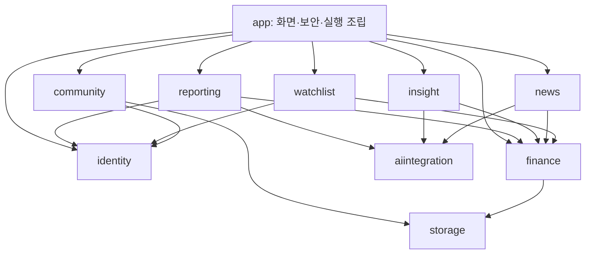

# SENTINEL Spring Modulith 경계와 서비스 추출 준비 설계

상태: **B01~B08 승인 범위 구현·검증 완료**. 2026-11-14 사용자 승인으로 설계를 구현했다. 확정된 11개 모듈과 59개 테이블 소유권은 `docs/architecture/module-ownership.md`, 실행·실패·보강 기록은 로컬 `perf/results/20261114-modulith/progress.md`에 남긴다. 아래 변경 전 관찰과 설계 의도를 현재 구현 결과와 구분한다. 실제 프로세스·DB 분리(B09)는 별도 후속 범위다.

## 1. 목표와 선택

하나의 Spring Boot 실행 파일 안에서 도메인의 공개 API, 데이터 소유권, 트랜잭션, 외부 의존성을 분리하고 테스트로 강제한다. 이후 AI 실행 또는 보고서 서비스를 추출할 때 바꿔야 할 지점을 한정한다. 패키지 모듈화가 네트워크 장애·분산 트랜잭션·운영 문제까지 자동 해결하지는 않는다.

권고는 **패키지 기반 Modulith → 경계 검증 → 추출 모의 검증 → 필요 시 Gradle 빌드 모듈/독립 서비스**다. 처음부터 Gradle 프로젝트를 여러 개로 나누면 현재 순환 참조, JPA 연관관계, SQL 결합을 해결하는 작업과 빌드 변경이 겹친다. 곧바로 MSA로 전환하는 대안은 DB/인증/운영 변경까지 포함하므로 이번 목적에 비해 범위가 크다.

- Java 21 / Spring Boot 3.5.9 / Gradle 8.14.3을 기준으로 한다.
- 공식 호환표상 Boot 3.5에 대응하는 Spring Modulith **1.4.x**를 검토한다. 조사 시 문서는 1.4.14를 표시했으나, 구현 착수 시 저장소 가용성·지원 상태·의존성 충돌을 확인하고 BOM 패치를 고정한다. B01에서 Maven 가용성과 실제 의존성 해석을 확인해 BOM 1.4.14와 API/test 의존성만 적용했다.
- 우선 `spring-modulith-api`, `spring-modulith-starter-test` 등 구조 검증에 필요한 의존성만 선택한다. 이벤트 저장소/외부화 스타터를 관성적으로 추가하지 않는다.
- 애플리케이션·Gradle·Docker·Python 실행은 계속 WSL Ubuntu에서 한다. 기존 원본 데이터와 사용자 변경을 보존한다.

## 2. 변경 전 코드에서 확인한 결합

기준 커밋: `7fac4c593ee297b7eea82e501b5825db68f7c715`. `settings.gradle`은 단일 프로젝트이며, 애플리케이션 Java 파일은 463개, 루트 하위 패키지는 20개다. 아래는 정적 import와 직접 읽은 소스에 따른 관찰이며 완전한 AST/SQL 의존성 조사 결과는 아니다.

| 관찰 | 현재 근거 | 변경 필요성 |
| --- | --- | --- |
| 인증과 사용자 상호 참조 | `auth` ↔ `user`, `common/config/SecurityConfig.java` → 인증 내부 타입 | 계정·인증을 identity로 묶고 발급과 자원 서버 검증을 구분 |
| 공통 패키지가 업무 도메인을 참조 | `common` → auth/company/file/user 등 | 업무 서비스·보안 조립·순수 공통 타입을 분리 |
| company에 많은 책임 집중 | 146개 파일, AI·뉴스·재무 조회·보고서 요청/worker 혼재 | 기업 마스터와 다른 도메인의 수명주기를 분리 |
| 보고서 접수 Repository의 다른 도메인 SQL | `ReportRequestRepository.requireUser/requireCompany/active/requireValues` | Java import 검증만으로 발견 못 하는 users/finance 직접 조회를 공개 API로 이전 |
| 접수와 완료의 원자성 | `ReportRequestService.accept`, `ReportCompletionService.complete` | 슬롯·요청·Outbox 및 artifact·완료·슬롯 해제의 로컬 트랜잭션 유지 |
| 보고서 입력에 적재 내부 타입 노출 | `ReportSourceData` → `CanonicalMetricCell` | 공개된 불변 source 계약으로 치환 |
| 관심기업 조회가 여러 도메인 Entity/QueryDSL 타입 사용 | `CompanyWatchlistRepositoryImpl`, `CompanyWatchlistEntity` | 배치 조회 API와 ID 참조로 전환, N+1 및 정렬/페이지 의미 검증 |
| 게시물과 파일 상호 참조 | `post` ↔ `file`, `FileService` → PostsRepository/UserEntity | 게시물 권한·첨부 연결은 community, 저장 기술·범용 파일 메타는 storage |
| 모의 생성 어댑터는 로컬 주소만 허용 | `HttpMockReportGenerationAdapter` | 원격 AI 준비와 로컬 테스트 보안 제한을 구분 |

## 3. 제안 모듈과 데이터 소유권

모듈은 서버 개수와 다르다. 아래 모든 모듈을 처음에는 동일 JVM/동일 DB에 배포한다. 별도 DB가 필요해지는 시점까지 기존 테이블명·PK·Flyway 이력을 유지한다.

| 제안 패키지 | 현재 코드의 이동 출처 | 책임과 소유 데이터 |
| --- | --- | --- |
| `identity` | auth, user, 인증 관련 common 일부 | 가입·로그인·계정 상태·역할·비밀번호·검증 메일·refresh/blacklist. users/roles/user_roles/refresh_tokens/email_verifications |
| `finance` | company의 마스터·DART·재무 개요, industry/quarter/metric/metricaverage/report/dataimport/risk 및 keymetric | 기업·재무 수치·버전·스냅샷·적재 원장·정량 위험/평균 read model. 회사/지표/버전/적재와 이에 종속된 정량 조회를 같은 경계에 두어 기존 활성 버전과 SQL 최적화를 보존 |
| `insight` | reportanalysis/insight | 사업보고서 해석과 뉴스/재무 결과 조립, report_analyses/report_contents. 실제 company_key_metrics·company_report_versions를 갱신하는 코멘트/신호/예측/건강점수 캐시는 finance가 소유하도록 B01~B06에서 확정 |
| `reporting` | company/reportrequest, reportjob, 맞춤 보고서 종속 messaging | 맞춤 보고서 접수·멱등성·한도·Outbox/Inbox·job/attempt/lease·artifact·관리 재개·상태 projection. report_requests/report_admission/report_jobs/report_attempts/report_artifacts/복구·전달 원장 |
| `aiintegration` | company/client/AiServerClient, 모의 생성 어댑터의 HTTP 전송 부분, AiWebClientConfig | AI 프로토콜·HTTP·timeout·오류 분류. 재무/사용자/보고서 Repository를 소유하거나 참조하지 않음. 실제 모델 서버 구현은 이 Java 모듈과 별개 |
| `watchlist` | watchlist | 사용자-기업 관심 등록 관계와 변경 정책. company_watchlists |
| `news` | company/news | 기사 수집·중복 제거·기사 분석 저장. news_articles/news_analyses. AI 호출은 aiintegration, 기업 확인은 finance API |
| `community` | post/comment/category/tag, 게시물 첨부 orchestration | 게시물·댓글·좋아요·태그·조회수·첨부 연결/권한. posts/comments/categories/tags 및 연결 테이블, post_files |
| `storage` | file의 저장 구현·범용 메타데이터·검증 | local/S3 I/O와 files. 게시물 권한은 community, 보고서 소유자·완료 artifact 메타는 reporting |

`report`라는 기존 패키지의 재무 원본/버전과 맞춤 AI 보고서의 업무 의미를 구분한다. 전자는 finance, 후자는 reporting이다. 기존 오래된 AI job과 새 맞춤 요청은 외부 호환성을 확인해 내부 adapter로 병행 수용하며, 근거 없이 삭제하거나 다른 흐름으로 합치지 않는다.

`finance`는 처음부터 ingestion·risk·reference 서비스를 별도 서버로 세분화하지 않는다. 활성 스냅샷 전환과 재무 버전/평균/위험 조회가 함께 지켜야 할 규칙이 많다. 필요하면 finance 내부 하위 패키지/중첩 모듈부터 검토한다. AI 예측 값이 재무 버전 테이블에 저장되는 기존 경로는 **insight의 계산 요청 → finance 공개 저장 명령**으로 다루며 insight의 직접 쓰기를 금지한다.

기술적 구성은 별도로 정리한다.

- `app`: 기존 dashboard/기업 종합 화면의 조립, HTTP 보안 체인·CORS·실행 설정·seed/CLI 조립. 공개 모듈 API만 사용하고 Entity/Repository에 접근하지 않는다. `ProjectApplication`은 루트에 유지한다.
- `foundation`: 공통 감사 기반/페이지/일반 오류 등 실제 공통인 최소 타입만 남긴다. 도메인 Entity/Repository, 범용 업무 DTO, 인증·AI 전용 예외를 이곳으로 모으지 않는다. 다른 도메인을 import하지 않는다.
- 검증/계측 전용 `perf`는 운영 의존성과 분리하고 기존 계측 지표를 보존한다. 테스트 지원 코드가 운영 공개 API를 불필요하게 확대하지 않게 한다.
- 메일 발송은 identity 내부 port/adapter로 시작한다. 알림 도메인 요건이 없는 상태에서 별도 서비스부터 만들지 않는다.

## 4. 공개 API와 허용 의존성

각 모듈은 `api`와 필요한 `spi/events`, `internal`로 구성한다. 공개 계약에는 ID, 불변 DTO, 명시적 오류만 노출한다. Entity/Repository, JdbcTemplate, JPA 프록시, 보안 개인 키를 반환하지 않는다. `@NamedInterface`와 `@ApplicationModule(allowedDependencies=...)`로 허용 인터페이스를 명시한다.

제안 의존 방향:

모든 모듈에서 foundation으로 향하는 의존은 그림에서 생략한다. reporting의 전용 artifact 저장은 reporting 소유 port와 내부 local adapter로 시작한다. 필요 시 storage의 순수 blob API로 위임하되, reporting 업무 메타를 storage로 옮기지 않는다. identity의 회원 이미지가 storage를 사용한다면 단방향 API만 허용한다.

계약 초안은 다음과 같다. 메서드/필드 확정은 구현 첫 단계에서 현재 HTTP/SQL 의미를 대조한 뒤 수행한다.

- `IdentityQueries.requireActive(long userId)` 및 `AccountState`: 기존 ACTIVE/deleted 정책 유지. 요청마다 로그인 서버에 원격 호출한다는 뜻은 아니다.
- `FinancialQueries.describe(CompanyIds, SnapshotId, Quarter)`와 `ReportSourceReader.read(SourceRef)`: snapshot ID, 회사 ID, 분기, schemaVersion, metricCode/값/단위/NULL 의미, checksum을 포함한 불변 DTO. 기존 canonical 자료와 의미 동등성을 시험한다.
- `ReportingCommands.accept(actorId, companyId, idempotencyKey, command)` / `ReportingQueries.status(actorId, requestId)`: 현재 key·입력 hash·권한·오류·상태 버전을 보존한다.
- reporting 내부 `ReportGenerationPort`는 유지하고 내부 adapter가 `aiintegration::api`의 AI 전송 계약에 매핑한다. aiintegration은 reporting 타입을 역참조하지 않는다. 재시도 정책의 주인은 reporting이며 HTTP client의 숨은 재시도를 추가하지 않는다.
- `WatchlistQueries.companyIds(actorId, query)`와 finance 배치 조회를 사용한다. 교차 모듈 join을 건당 호출로 바꾸지 않는다. 필터·정렬·전체 건수·페이지 경계가 바뀌는 경우 조회 계획을 먼저 재설계하고 측정한다.

`ApplicationModules.verify()`는 모듈 순환·내부 타입 접근·허용 의존성을 검사한다. 문자열 SQL/JPQL, reflection, DB FK, 실행 중 동적 접근까지 자동 검증하는 것은 아니다. 테이블 소유권 목록, SQL 접근 시험, JPA 연관관계/공개 반환 타입 ArchUnit 규칙을 추가한다. SQL 정규식 검사는 보조 수단이며 대표 흐름의 실제 SQL과 MySQL 최소 권한 검증을 함께 사용한다.

## 5. 정합성과 이벤트 계약

1. **접수**: 요청/멱등 키/수락 snapshot·입력/슬롯/Outbox는 reporting의 한 트랜잭션으로 저장한다. identity와 finance 검증은 해당 모듈 API를 호출하되 초기에는 같은 DB에서 기존 격리·호출 순서를 유지한다. 이를 HTTP 호출로 바꾸지 않는다.
2. **전달**: 기존 MySQL Outbox → Debezium CDC → Kafka → Inbox+job commit 후 ACK를 유지한다. 현 OutboxWriter/Inbox는 reporting 업무 타입에 종속되므로 reporting 내부로 옮긴다. 전 모듈의 공용 event bus라는 이름으로 역의존을 남기지 않는다.
3. **완료**: 외부 AI 호출은 DB 트랜잭션 밖에서 수행하고, current lease 검증/attempt/artifact/상태/슬롯 해제/상태 Outbox를 기존 완료 트랜잭션으로 확정한다. consumer와 worker는 처음에는 같은 reporting 모듈이다.
4. **캐시/부가 반영**: 재구성 가능한 캐시·projection은 지연 허용 범위와 재구축 절차를 명시한다. Redis 상태 캐시는 기본 off와 owner/version 검증·DB fallback을 유지한다. Spring 내부 비동기 이벤트를 사용한다면 유실 허용/재구축 가능 여부를 명시한다.
5. **영속 이벤트**: 전송 보장이 필요한 업무에는 기존 Outbox 경로를 사용한다. 같은 사건을 Modulith 이벤트 저장소/외부화와 CDC로 동시에 발행하지 않는다. 나중에 Modulith Event Publication Registry를 선택한다면 어떤 업무의 어떤 경로를 대체하는지 별도 ADR과 중복/재시작 시험을 먼저 작성한다.

초기 모듈화는 기존 테이블·DB FK를 보존할 수 있다. Java 연관을 scalar ID로 바꾸더라도 DB FK가 남아 있으면 물리적 독립은 아니다. 테이블별 writer/read API/FK/삭제 정책/마이그레이션 주체를 목록화하고, 타 모듈 Repository/SQL의 직접 읽기·쓰기를 공개 계약으로 옮긴다. 중간에 필요한 legacy bridge는 파일·건수·제거 작업을 기록하고 최종 경계 검증에서 무기한 예외로 허용하지 않는다.

## 6. 인증 서버 분리와 AI 서버 분리의 차이

**identity**: 발급·refresh·메일·계정 상태는 identity, 각 업무의 소유자 권한은 해당 업무 모듈이 책임진다. 자원 서버 JWT 검증 정책과 발급 개인 키를 분리한다. 현재 blacklist/즉시 로그아웃/계정 정지 의미를 단순 stateless JWT로 약화하지 않는다. 실제 분리 시 JWKS/kid/issuer/audience, 키 회전, 폐기 전파/캐시 TTL과 최대 지연, 인증 저장소 장애 시 허용/거절 정책을 확정하고 시험한다. 독립 OAuth/OIDC 제공 서버를 새로 구축하는 작업은 별도 범위다.

**AI**: Modulith가 분리하는 것은 Java의 AI 연동 책임이다. 실제 추론/모델 로딩 서버는 별도 실행체이며 현재는 로컬 mock으로 계약을 검증한다. 기존 loopback 제한을 제거해 아무 원격 URL이나 허용하는 변경은 하지 않는다. 실제 제공자가 정해지면 별도 remote adapter와 설정/허용 대상/응답 계약을 추가한다. timeout/응답 유실에서는 원격 호출이 중복될 수 있으며 requestId 전달만으로 exactly-once가 보장되지는 않는다.

## 7. 단계와 최종 완료 기준

실행 계획은 [단계별 계획](../plans/2026-11-14-modulith-migration-plan.md)을 따른다. 이번 권고 구현 범위는 **B01~B08: 단일 배포 Modulith의 경계 정리·기존 동작/데이터/성능 회귀·증거 정리**다. B09 실제 서비스 분리는 별도 후속으로 둔다.

- 최종 모듈 순환 0, 허용되지 않은 내부 접근 0, 다른 모듈 Entity/Repository 직접 참조 0. 전환 중 한시 예외와 최종 수치를 구분한다.
- 다른 모듈 테이블 직접 SQL은 목록화 후 소유 모듈 공개 API로 이전한다. 모듈 간 읽기는 배치 API/명시적 read model로 대체하고 결과·페이지·정렬 동등성을 검증한다.
- 기존 API URL/DTO/상태 코드/멱등성/오너 권한과 artifact·슬롯·ACK 규칙을 보존한다. 과거 이벤트 JSON을 새 코드가 읽는 호환 시험을 통과한다.
- 기존 데이터 전체 지문/카운트·snapshot ID·파일을 비교한다. package-only 전환에는 기존 Flyway 수정이나 데이터 재적재가 필요하지 않아야 한다.
- 선택 실행 시험의 실패/error 0, 신규 skip 0. 이전 최종 기록 Java 607 pass/15 기존 disabled·Python104는 과거 기준이며 새 코드 실행 결과가 아니다. strict gate의 기존 INCOMPLETE를 숨기지 않는다.
- 성능은 이전 수치를 재사용하지 않고 같은 원본·워크로드·조건의 새 기준선을 만든다. 결과 동등성·SQL 수/요청·P95·성공 TPS·에러율·완료 지연을 전후 비교하고 조건/편차/회귀 원인을 함께 남긴다. 모듈화로 성능이 좋아진다고 미리 주장하지 않는다.

향후 추출은 비용과 목적에 따라 선택한다. AI 실행 경계 검증 → reporting 전체의 독립 실행/전용 데이터 소유권 검증 → 필요 시 identity 분리 순을 기본 권고로 삼는다. worker만 별도 프로세스로 띄우고 같은 DB를 쓰는 것은 중간 실행 토폴로지 시험이며 독립 MSA 완료로 표현하지 않는다.

reporting 추출 전에 finance에서 snapshot을 읽고 내부 DB에 요청을 쓰는 두 동작의 원자성이 사라진다. `SourceRef` 확보/불변 payload 복사 또는 보존 예약/만료/접수 실패 정리/중복 접수/삭제·재개 계약을 먼저 정해야 한다. 모듈 API를 단순 HTTP로 바꾸거나 분산 트랜잭션을 암묵적으로 기대하지 않는다. 같은 방식으로 계정 정지의 전파 지연, storage 저장과 메타 확정 사이의 고아 파일 정리도 다시 설계한다.

## 8. 근거 문서

- [Spring Modulith 1.4 / Boot 호환표](https://docs.spring.io/spring-modulith/reference/1.4/appendix.html)
- [모듈·NamedInterface·명시적 의존](https://docs.spring.io/spring-modulith/reference/1.4/fundamentals.html)
- [모듈 구조 검증](https://docs.spring.io/spring-modulith/reference/1.4/verification.html)
- [모듈 통합 시험](https://docs.spring.io/spring-modulith/reference/1.4/testing.html)
- [이벤트·발행 저장소와 비동기 유실 경계](https://docs.spring.io/spring-modulith/reference/1.4/events.html)
- [기존 Outbox 결정](../../adr/0001-outbox-relay.md), [Kafka 선택](../../adr/0002-kafka-selection.md), [Redis 적용 범위](../../adr/0003-redis-scope.md)

## 구현 중 확정 사항 (2026-11-14)

- 현재 책임·59테이블 정책·16개 교차 모듈 FK·로컬 트랜잭션/CLI 조립은 [모듈 소유권 문서](../../architecture/module-ownership.md)를 기준으로 한다.
- 기존 CompanyAiService/CompanyAiReportStoreService/Redis legacy 상태는 finance의 버전 데이터 책임이다. 기존 범용 dispatch와 HTTP는 aiintegration, 교차 업무 consumer는 app으로 구분했다.
- 보고서 파일 메타는 storage의 공개 API를 통해 저장·대조하며 완료 트랜잭션에 참여한다. 이는 독립 HTTP 저장소로 분산한 상태가 아니다.
